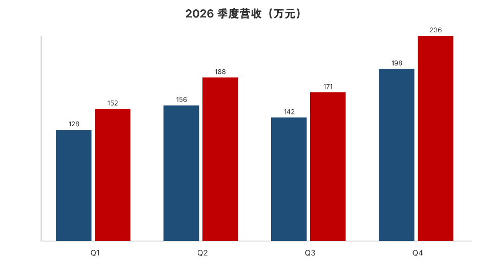
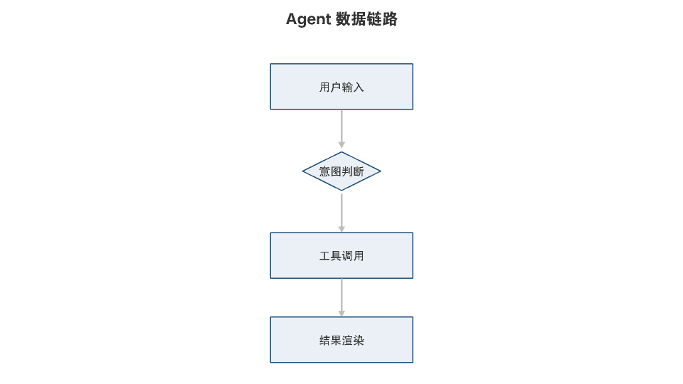
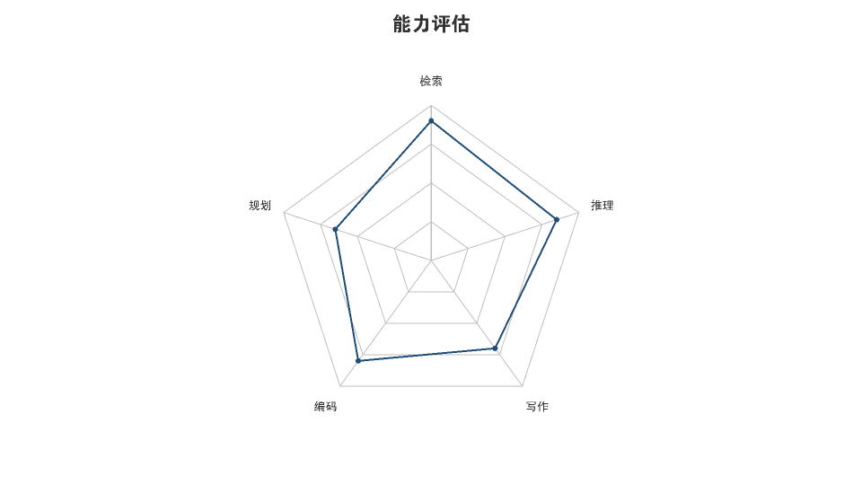

# Diagram — JSON 到图

**Write a few dozen tokens of JSON, get a chart.** 15 chart types + decorative illustrations, rendered locally in pure Python (fontTools + stdlib). No Pillow, no browser, no ImageMagick, no API calls.

一个给 AI Agent 用的画图 skill：模型只输出**几十 token 的 JSON**，本目录脚本负责把结构渲染成 **PNG / SVG / PPT 原生矢量形状**。

- 纯 Python 光栅化：`fontTools` 取字形轮廓 → 扫描线填充（even-odd）→ 2× 超采样 → zlib 编码 PNG
- **零外部服务**：不联网、不调生图 API、不需要 Pillow / cairo / 浏览器
- 实测 **0.2–0.3 秒/张**（960×540，纯 Python 逐像素）
- 输出 PPTX 时是**原生矢量形状**，PowerPoint / WPS 里可继续编辑

## 效果








## 为什么做这个

让模型画图通常有三条路，都有明显代价：

| 做法 | 问题 |
|---|---|
| 模型手写 SVG | token 消耗大、坐标容易算错、复杂图基本画不出来 |
| 调外部生图 API | 联网、花钱、出的是像素图不能改，且数据图数字经常错 |
| 调 matplotlib / 浏览器截图 | 依赖重，嵌入式/移动端装不上 |

这个项目的取舍：**模型只描述"结构"（类型 + 数据 + 标题），排版与像素交给确定性代码**。同样的输入，输出稳定、可复现、可嵌入 PPT。

## 支持的图

| 类别 | type |
|---|---|
| 对比 / 趋势 | `bar`（分组柱）、`hbar`（条形）、`line`、`area` |
| 构成 | `pie`、`donut`、`funnel`、`waterfall` |
| 分布 / 关系 | `scatter`、`heatmap`、`radar` |
| 流程 / 排期 | `flow`、`timeline`、`gantt`、`matrix` |
| 装饰插画 | `decor`：`cover` 封面横幅 / `pattern` 底纹 / `icon` 扁平图标（10 种） |

完整 JSON schema 见 [SKILL.md](SKILL.md)。

## 安装

```bash
git clone https://github.com/KongBai-lab/dsh-skill-diagram.git
cd dsh-skill-diagram
pip install fonttools
```

还需要一个中文字体（Linux 上 `apt install fonts-noto-cjk` 即可）。脚本会自动在 `/system/fonts`、`/usr/share/fonts`、`~/.fonts`、Windows/macOS 字体目录里查找；找不到时：

```bash
export DIAGRAM_FONT_DIR=/path/to/fonts
```

## 快速开始

```bash
# PNG
python scripts/diagram_png.py --spec examples/bar.json -o bar.png --width 960 --height 540

# SVG
python scripts/diagram.py --spec examples/bar.json -o bar.svg

# PPTX（原生矢量形状）
python scripts/diagram.py --spec examples/bar.json -o bar.pptx
```

Python 里调用：

```python
import sys, json
sys.path.insert(0, "scripts")
import diagram_png

spec = {
    "type": "bar", "title": "季度营收（万元）",
    "categories": ["Q1", "Q2", "Q3", "Q4"],
    "series": [{"name": "2026", "values": [152, 188, 171, 236]}],
}
diagram_png.render_png(spec, "bar.png", width=960, height=540)
```

## 作为 Agent Skill 使用

本仓库根目录的 `SKILL.md` 同时包含两套 frontmatter：

- `name` + `description`：DeepSeek Harness / Claude Code 等按 this 格式加载；
- `slug` + `displayName` + `version` + `summary` + `license`：可直接发布到 SkillHub / ClawHub 类市场。

**DeepSeek Harness**：把本目录放到 `$DSH_HOME/skills/diagram/`，重启会话即可（或按你的 loader 规则平铺成 `diagram.md`）。

**Claude Code**：放到 `~/.claude/skills/diagram/`。

## 目录结构

```
dsh-skill-diagram/
├── SKILL.md              # 给 Agent 读的技能说明（含全部 JSON schema）
├── README.md
├── LICENSE               # MIT
├── requirements.txt
├── scripts/
│   ├── diagram.py        # SVG / PPTX 渲染器
│   ├── diagram_png.py    # PNG 渲染器（入口）
│   ├── raster.py         # 字体轮廓 → 多边形 → 扫描线 → PNG
│   ├── decor.py          # 封面 / 底纹 / 图标
│   └── pptx_builder.py   # 极简 PPTX（OOXML）写出器
└── examples/             # 示例 spec 与生成结果
```

## 环境变量

| 变量 | 作用 |
|---|---|
| `DIAGRAM_FONT_DIR` | 字体目录；不设置时按平台自动探测 |
| `DIAGRAM_PYLIBS` | 额外的 site-packages 目录（嵌入式环境用） |
| `DIAGRAM_OUT` | 默认输出目录 |

## 限制

- 不生成照片、写实插画、3D；只做数据图与几何/扁平装饰。
- PNG 为光栅化结果，放大不如 SVG；需要无损缩放请用 SVG 出口。
- 图内长文本不自动换行，标题请自行控制长度。
- 生僻汉字可能缺字形。

## License

MIT。见 [LICENSE](LICENSE)。
